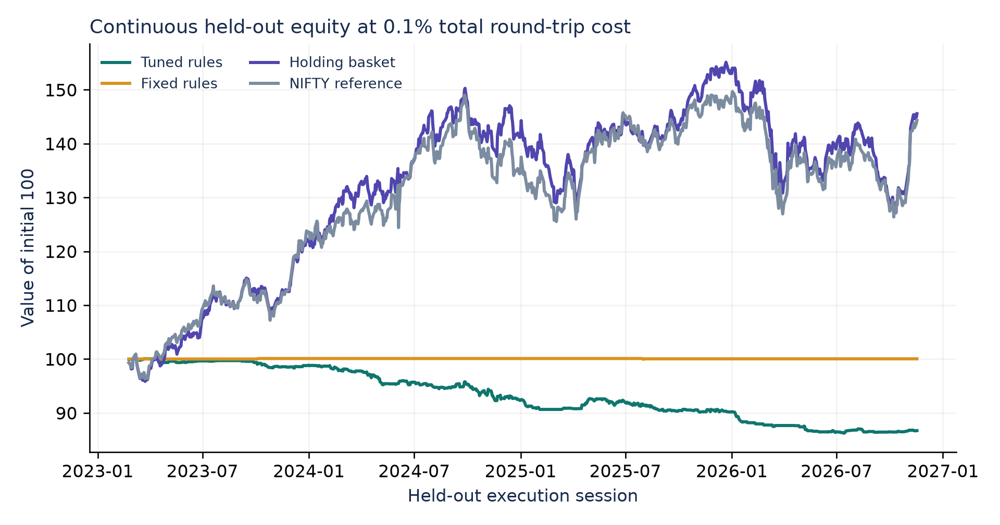
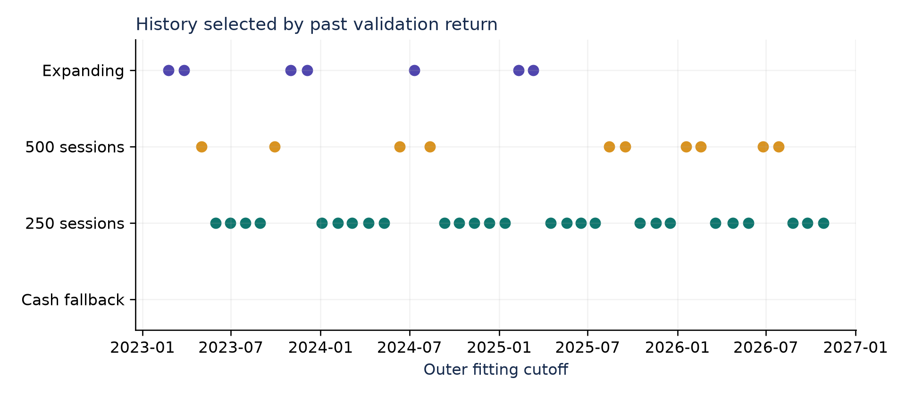
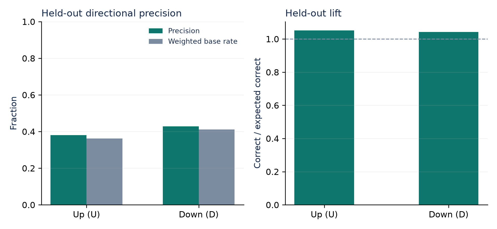

# Mining Stock Price Data to Discover Temporal Trends and Market Patterns

CS G520 Advanced Data Mining - BITS Pilani Hyderabad

Tanish Kumar Gupta (team leader) and Aayush Gupt

## Abstract

We investigate adaptive history length, automated association-rule thresholds and trading-cost-aware evaluation for 10 selected Indian equities. The frozen snapshot has 1,482 sessions per instrument. Nested validation scores 3,564 configurations across 44 outer folds, covering 917 held-out sessions. At 0.1% total round-trip cost, tuned rules return -13.30%, fixed rules 0.04%, and the equal-initial-weight holding basket 45.57%. The application presents frozen evidence and preserves negative results and cash fallbacks.

## Motivation and contribution

The Phase 1 survey motivates G1 (adaptive forgetting), G2 (manual thresholds) and G3 (economic validation). This implementation addresses or investigates these gaps; it does not claim to solve market prediction. Srivastava et al. (2024) motivate inter-stock association mining, Nair et al. (2015) temporal ARM and Nair et al. (2017) alternative recommendation configurations. Tusien et al. (2025) and Tsinaslanidis (2018) motivate a descriptive U/D comparison. This is a methodological comparison, not a direct numerical replication.

## Data and quality audit

Source coverage: 2020-11-17 to 2026-11-17; 10 selected stocks plus the NIFTY 50 price index. The universe is a present-day convenience sample rather than reconstructed historical index membership. Prices are provider-adjusted OHLC; cash dividends and split information are retained. No prices are forward-filled.

HDFCBANK.NS, ICICIBANK.NS, INFY.NS, ITC.NS, LT.NS, MARUTI.NS, RELIANCE.NS, SBIN.NS, SUNPHARMA.NS, TCS.NS

Data audit found nine flat, zero-volume stock placeholders on 18 March 2025. Primary NSE EQ OHLCV replaced only those rows in a new immutable snapshot. The previous adjusted-close / NSE previous-close ratio sets the price scale; the following session independently verifies it within 1e-5. All original and replacement values and primary-file hashes are retained. The separate verified 15 January 2026 exchange closure is excluded for all instruments. This uses a static adjusted-price archive and does not establish point-in-time corporate-action accuracy.

## Method

Feature at close t: close[t]/close[t-1]-1. Target: close[t+1]/open[t+1]-1. U is above theta, D below -theta, and N otherwise; threshold equality is N. Targets become training information only after execution-session close. Each transaction has one feature and one NEXT_ outcome per stock. Apriori itemsets have length at most three; eligible rules have one/two observed antecedents, exactly one NEXT_ consequent and training lift > 1.

Grid: windows {250,500,expanding}; theta {0.25%,0.5%,1%}; support {1%,2%,5%}; confidence {55%,60%,70%}. All 81 configurations face the same preceding 63 validation executions. Selection maximizes net validation portfolio return at 0.1% cost, requiring 20 trades across five sessions. Exact score ties use canonical parameter ordering. Winners refit through the outer cutoff and freeze for the next 21 executions; the final partial block is retained. No eligible configuration means cash. Fixed control: 500 / theta 0.5% / support 2% / confidence 60%.

U signals buy at the next open and sell that close; D/N/unknown stay in cash. Highest training confidence resolves matches; class conflicts at identical top confidence mean cash. Each stock has 1/N of current pre-session equity; unused allocations remain cash. Full-run capital compounds across fold boundaries. Every cost scenario uses the same frozen decisions. Costs are flat total round-trip fractions of entry notional, not broker-specific tax/fee schedules. The 0.5% case is a stress scenario; exact replication of Nair's fee convention is not claimed.

## Results

Held-out interval: 2023-02-24 to 2026-11-17; 917 sessions, 44 folds. NIFTY is an uncosted price-index reference.

| Round-trip cost | Tuned return | Fixed return | Holding basket |
| --- | --- | --- | --- |
| 0.05% | -8.48% | 0.05% | 45.62% |
| 0.10% | -13.30% | 0.04% | 45.57% |
| 0.50% | -43.78% | -0.08% | 45.17% |

| Metric | Tuned rules | Fixed rules | Holding basket | NIFTY reference |
| --- | --- | --- | --- | --- |
| Net return | -13.30% | 0.04% | 45.57% | 44.32% |
| CAGR | -3.75% | 0.01% | 10.58% | 10.33% |
| Sharpe | -1.60 | 0.10 | 0.87 | 0.85 |
| Max drawdown | 13.94% | 0.14% | 18.17% | 15.77% |
| Profit factor | 0.73 | 1.24 | 10.18 | N/A |
| Win rate | 45.38% | 66.67% | 70.00% | N/A |
| Round trips | 1082 | 3 | 10 | N/A |

Tuned-minus-fixed return is -13.34 percentage points at 0.1% cost. This compares the complete tuning procedure; it cannot attribute a difference specifically to window choice without an ablation. Holding controls retain overnight exposure while the rule strategy is intraday, so exposure and opportunity differ.



## Tuning and drift

44 of 44 folds selected an eligible configuration; 0 used the explicit cash fallback. Winning histories: 250=27, 500=10, expanding=7. Window changes investigate adaptive forgetting; they do not identify a causal regime change or prove concept drift was detected.



## Held-out asymmetry

| Direction | Forecasts | Correct | Precision | Base rate | Lift |
| --- | --- | --- | --- | --- | --- |
| U | 1082 | 412 | 38.08% | 36.20% | 1.05 |
| D | 2273 | 974 | 42.85% | 41.12% | 1.04 |

Down-prediction lift is lower than up-prediction lift in this sample (1.04 versus 1.05). This is descriptive evidence, without a significance test or a claim of a universal bearish advantage.

Within each fold/stock, estimate class base rate using its selected theta. Sum forecast_count x group_base_rate to obtain expected correct counts. Aggregated precision = correct/forecasts; weighted base rate = expected/forecasts; lift = correct/expected. All realized outcomes are read after predictions are frozen. These base rates never tune the model.



## Worked ledger example

First chronological tuned trade: ICICIBANK.NS, 24 February 2023. Entry notional INR 10,000.00; open 816.68; close 812.56. Gross PnL INR -50.36; cost 0.1% x notional = INR 10.00; net PnL INR -60.36. These are saved ledger values, not illustrative invented returns.

## Validation and limitations

Tests cover future-data perturbation, mature outcome cutoffs, NEXT_ direction guards, simultaneous capital budgets, overnight-gap exclusion, round-trip costs, first-loss drawdown, continuous multi-fold equity, exact objective ties, final partial blocks, immutable artifacts, weighted asymmetry, completed latest cohorts and offline app behavior. The production experiment runs with networking denied. App pages read checksummed precomputed artifacts; only an explicit Latest Signals refresh contacts Yahoo.

Current-stock selection causes survivorship/selection bias. Provider-adjusted prices are not point-in-time. Idealized fills omit detailed liquidity, market impact, taxes and execution queues. Searching 81 settings can overfit validation. Stocks and overlapping historical windows are dependent; no significance or universal directional edge is claimed. Tuning-vs-fixed combines G1/G2 and is not an ablation. A negative return or failure to beat holding is a valid finding.

Metrics: net return, calendar CAGR (inclusive dates, 365.25 days/year), sample daily Sharpe (252, risk-free zero), drawdown including initial capital, profit factor and win rate from net currency PnL, and trade count. Undefined metrics are N/A; positive profit factor without losses is infinite. Holding controls pay cost once, half entry/half final exit on initial notional, with no basket rebalancing.

## Reproduction and application

```bash
make test
make reproduce
make report
make app
```

Research reproduction requires the frozen corrected snapshot under data/raw/full_ten_stocks_corrected. The self-contained local archive includes it. A fresh GitHub checkout can display the packaged results without raw data. See docs/DEPLOYMENT.md and docs/DEMO.md. Live deployment status and exact verified test count are recorded in README.md; account acceptance is not inferred.

Frozen source SHA-256: `5286eeaa261ed3abdae66fc105971a2dc78c0e5d134dd761f2bd6fbbe70f0c34`

## References

1. Srivastava, T., Mullick, I., and Bedi, J. (2024). Association mining based deep learning approach for financial time-series forecasting. Applied Soft Computing 155, 111469. [https://doi.org/10.1016/j.asoc.2024.111469](https://doi.org/10.1016/j.asoc.2024.111469)
2. Nair, B. B., et al. (2015). A stock trading recommender system based on temporal association rule mining. SAGE Open 5(2). [https://doi.org/10.1177/2158244015579941](https://doi.org/10.1177/2158244015579941)
3. Nair, B. B., Kumar, P. K. S., Sakthivel, N. R., and Vipin, U. (2017). Clustering stock price time series data to generate stock trading recommendations: An empirical study. Expert Systems with Applications 70, 20-36. [https://doi.org/10.1016/j.eswa.2016.11.002](https://doi.org/10.1016/j.eswa.2016.11.002)
4. Tusien, E., Kwasniewska, A., and Weichbroth, P. (2025). Mining frequent sequences with time constraints from high-frequency data. International Journal of Financial Studies 13(2), 55. [https://doi.org/10.3390/ijfs13020055](https://doi.org/10.3390/ijfs13020055)
5. Tsinaslanidis, P. E. (2018). Subsequence dynamic time warping for charting: Bullish and bearish class predictions for NYSE stocks. Expert Systems with Applications 94, 193-204. [https://doi.org/10.1016/j.eswa.2017.10.055](https://doi.org/10.1016/j.eswa.2017.10.055)

Primary data audit: [NSE 18 March 2025](https://archives.nseindia.com/products/content/sec_bhavdata_full_18032025.csv), [NSE 19 March 2025](https://archives.nseindia.com/products/content/sec_bhavdata_full_19032025.csv), [NSE closure circular](https://nsearchives.nseindia.com/content/circulars/CMTR72260.pdf).

Software: [mlxtend Apriori](https://rasbt.github.io/mlxtend/user_guide/frequent_patterns/apriori/), [yfinance download](https://ranaroussi.github.io/yfinance/reference/api/yfinance.download.html), [Streamlit](https://docs.streamlit.io/).

> **Key Insight:** Parameters are chosen on past validation data; later test outcomes judge the frozen procedure. Attractive training rules and a changing window alone do not establish an economic advantage.
